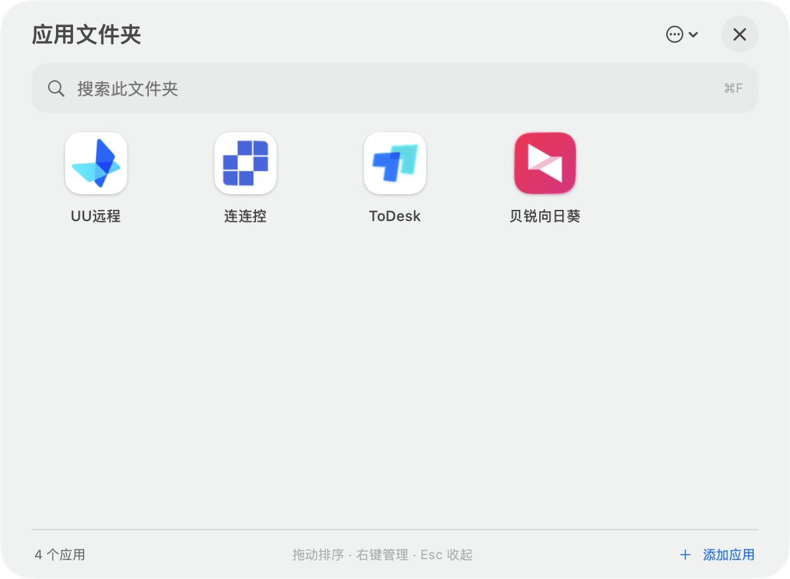
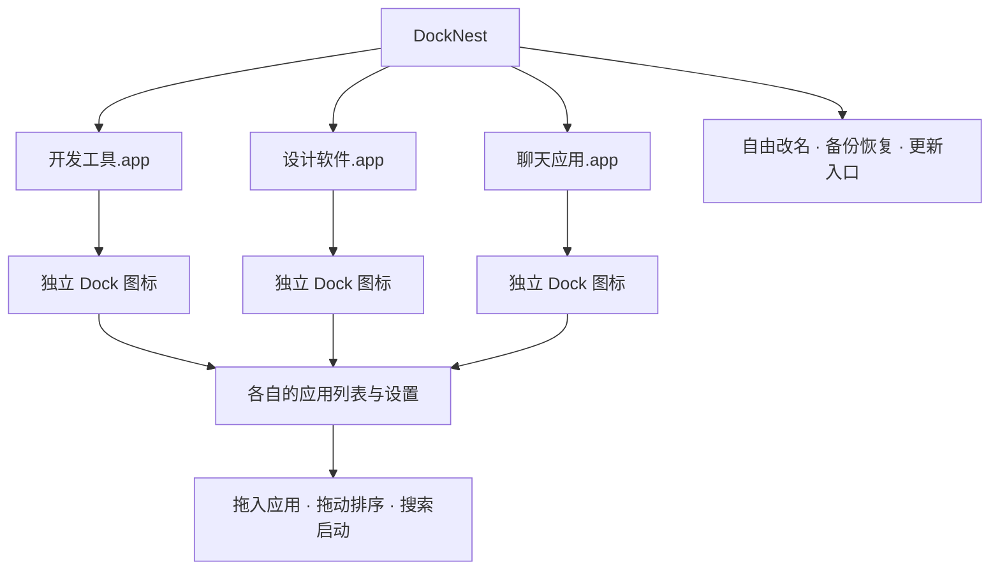
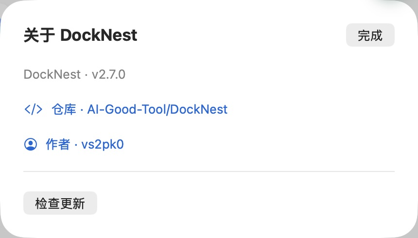

# DockNest

**把应用收进程序坞里的小窝，让每一类工具都有自己的位置。**

DockNest 是面向 **macOS 26** 的原生应用文件夹工具，使用 SwiftUI + AppKit 构建，无第三方依赖。一个文件夹对应一个独立 `.app`、一个独立 Dock 图标；开发工具、设计软件、聊天应用可以同时展开，各自整理。

[下载最新版](https://github.com/AI-Good-Tool/DockNest/releases/latest) · [使用说明](docs/USAGE.md) · [作者](https://github.com/vs2pk0)

## 界面预览



## 主要功能

| 功能 | 使用体验 |
| --- | --- |
| **独立多开** | 创建多个文件夹，同时运行、分别固定在 Dock；每个文件夹拥有独立应用列表和设置。 |
| **自由改名** | 「开发工具」「设计灵感」「日常办公」随心命名，窗口、Finder 与 Dock 同步使用新名称，列表与顺序保留。 |
| **拖拽添加** | 从 Finder 拖入应用或应用替身，也能直接拖到对应 Dock 图标；支持一次添加多个应用。 |
| **拖动排序** | 按住图标即可移动，其他图标实时让位；边缘自动滚动，松手保存顺序。 |
| **快速启动** | 点击图标打开应用，输入名称搜索，回车启动首个结果。 |
| **动态缩略图** | Dock 显示前四个应用的组合图标，正常退出后仍保留缩略图。 |
| **管理与恢复** | 集中打开、恢复和更新多开入口；旧入口升级保留名称和应用列表。 |
| **备份与自启动** | JSON 导入/导出支持合并或替换，每个文件夹可单独设置登录时启动。 |

移除文件夹里的快捷方式不会卸载原应用。搜索时暂停拖动排序，清空搜索后即可继续整理。

## 功能关系图



## 安装与使用

1. 从 [Releases](https://github.com/AI-Good-Tool/DockNest/releases/latest) 下载 `DockNest-版本号-macOS-arm64.dmg`。
2. 打开 DMG，将 `DockFolder.app` 拖到「应用程序」，再启动。
3. 从 Finder 拖入应用；按住图标拖动，安排喜欢的顺序。
4. 右上角 `…` → **修改应用名称…**，给当前文件夹取名。
5. `…` → **新建独立文件夹…**，创建更多分类。分别右键 Dock 图标 →「选项 → 在程序坞中保留」。

**系统要求：macOS 26 或更新版本，Apple Silicon（arm64）。** 当前发布包使用 ad-hoc 签名，尚未经过 Apple Developer ID 签名和公证；如被系统阻止，请在确认下载来源后，到「系统设置 → 隐私与安全性」查看允许打开选项。

为兼容已有版本，安装程序名仍为 `DockFolder.app`，数据继续保存在 `~/Library/Application Support/DockFolder/`。已有多开入口请通过「管理多开文件夹 → 全部更新」升级。具体恢复方式、快捷键和图标说明见 [完整使用说明](docs/USAGE.md)。

## 关于与更新



`…` → **关于 DockNest…** 可访问仓库、作者主页并手动检查更新。发现新版本时提供 Releases 下载入口，不会自动替换正在使用的文件夹。

## 本地开发

安装 Xcode 26 或更新版本，打开 `DockFolder.xcodeproj`，选择 `DockFolder` scheme 和 `My Mac`。

```sh
zsh "scripts/test.sh"
zsh "scripts/build.sh"
zsh "scripts/test-dock-plugin.sh"
zsh "scripts/package-dmg.sh"
```

构建仅输出 arm64；安装包和 SHA-256 校验文件位于 `dist/`。Swift Package 用于核心逻辑测试，GUI 由 Xcode 工程构建。

## 自动发布

推送与 `DockFolder/Info.plist` 版本一致的标签（例如 `v2.7.0`），GitHub Actions 会在 macOS arm64 runner 上运行测试、构建应用、验证架构与签名，最后将 DMG 和 SHA-256 校验文件发布到 GitHub Releases。也可在 Actions 页面手动选择已有版本标签运行。
